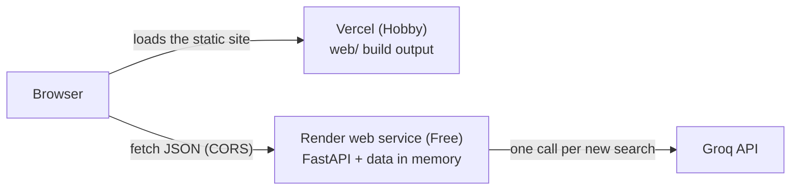

# Deployment Plan: API on Render, Front End on Vercel

This plan puts Curated Cravings online: the FastAPI service on [Render](https://render.com) and the front end on [Vercel](https://vercel.com). It builds on [architecture.md](architecture.md) and [implementation-plan.md](implementation-plan.md), and uses the same format: each phase has a goal, tasks, deliverables and **exit criteria**, and a phase is done only when all of its exit criteria pass.

> **Status (2026-10-30):** the code for Phases 1 and 3 is done and its exit criteria pass locally. Phases 2, 4 and 5 happen in the Render and Vercel dashboards and haven't started. Everything, `data/processed/` included, is pushed to the `deployment-setup` branch; Render and Vercel deploy from `main` once it's merged.

---

## The one thing to know first

**The current front end can't run on Vercel.** `ui/streamlit_app.py` is a Streamlit app, and Streamlit is a long-running Python server that keeps a WebSocket open to each browser tab. Vercel hosts static files and short-lived functions, so there's nothing on it that can run that server.

Putting the front end on Vercel therefore means **rebuilding the UI as a static web app** (`web/`, Phase 3) that calls the API from the browser. That's most of the work in this plan. The API itself needs only small changes.

If the goal is just to get the app online quickly, [Option B](#option-b-keep-streamlit-and-host-it-on-render) at the end runs the existing Streamlit UI as a second Render service instead, in about an hour, without using Vercel.

---

## Target setup



| Part | Host | Plan | Address |
|---|---|---|---|
| API (`app/`) | Render web service, region `singapore` | Free | `https://curated-cravings-api.onrender.com` (the exact name is assigned when the service is created) |
| Front end (`web/`, new) | Vercel project, root directory `web` | Hobby (free, non-commercial) | `https://curated-cravings.vercel.app` (likewise) |
| LLM | Groq | Free tier | already used locally |

The browser talks to Render directly. The other option is to proxy through a Vercel rewrite (`/api/*` to Render), which would avoid CORS. Vercel doesn't document a timeout for rewrites to an external origin, though, and a free Render instance can take a minute or more to wake up. Direct calls with CORS behave predictably.

---

## Facts that shape this plan

Checked on 2026-10-30 against the code, the platforms' documentation and a local run.

| Finding | Consequence |
|---|---|
| The UI is Streamlit (see above) | Rebuild it as a static app for Vercel (Phase 3), or use Option B |
| `data/` is git-ignored, and the ingest downloads a 574 MB CSV and needs about 1.5 GB of disk. The processed output (`data/processed/`) is only **3.4 MB** | Commit the processed data, so Render never runs the ingest (task 1.3) |
| `tests/unit/test_repo_files.py` asserts that `restaurants.parquet` **is** git-ignored | That test changes with task 1.3 |
| Render's default Python for services created on or after 2026-10-12 is **3.14.8**. The project supports 3.11–3.13 (pyarrow wheels) | Pin the version with a `.python-version` file (task 1.1) |
| Measured locally with the LLM off: the API uses **about 205 MB** of memory after startup and a search, and takes **about 14 s** to start (loading 12,415 restaurants) | Fits a 512 MB Free instance with one worker. Startup will probably be slower on Render's smaller CPU share |
| The API has no CORS middleware. Streamlit never needed it, because it calls the API from its own server | Add CORS, limited to the Vercel origins (task 1.4) |
| `requirements.txt` includes Streamlit, `datasets`, pytest and ruff, none of which the API needs at runtime (`datasets` is imported only inside the ingest) | Split out `requirements-api.txt` for faster, smaller Render builds (task 1.2) |
| The budget labels ("Low · ≤ ₹300") read `BUDGET_LOW_MAX` and `BUDGET_MEDIUM_MAX` from `app.config` directly | A browser app can't import them, so add `GET /meta/budgets` (task 1.5) |
| Free Render services spin down after 15 minutes without traffic and take about a minute to wake. There's no persistent disk | The front end must handle a slow first request (Phase 3), and logs and the LLM cache don't survive a restart |
| The GitHub repository is **public**, and the Hugging Face dataset page has no license or dataset card | Check the terms before committing a copy of the data (task 1.3) |
| Groq's free tier allows 200,000 tokens a day, about 37 new searches, and the evaluation harness spends the same allowance | Public traffic can use it up. The fallback ranking keeps the app working (see [Operations](#operations)) |

---

## Phase Overview

| Phase | Name | Outcome | Size | Depends on |
|---|---|---|---|---|
| 1 | Prepare the API for hosting | Pinned Python, runtime requirements, committed data, CORS, `/meta/budgets`, `render.yaml` | S | – |
| 2 | Deploy the API on Render | Public API URL; `/health` reports the LLM `configured` | S | 1 |
| 3 | Build the web front end | `web/`: a static Vite + React app with the same features as the Streamlit UI | L | 1 |
| 4 | Deploy the front end on Vercel | Public site URL | S | 2, 3 |
| 5 | Connect, verify and document | CORS limited to Vercel, end-to-end smoke test, README updated | S | 4 |

Phases 2 and 3 can run in parallel: the front end is built against the local API.

---

## Phase 1: Prepare the API for Hosting

**Goal:** a fresh clone of the repository can start the API on Render with no manual steps.

**Tasks**

- [x] **1.1 Pin Python.** Add `.python-version` at the repository root containing one line, `3.13`. Render uses the latest 3.13 patch release. Don't use the `PYTHON_VERSION` environment variable instead: it needs a full version such as `3.13.5`.

- [x] **1.2 Split the runtime requirements.** Add `requirements-api.txt` with only what the API imports, and have `requirements.txt` include it, so each version is still pinned in one place:

  ```text
  # requirements-api.txt: what the API needs at runtime (installed on Render).
  # Requires Python 3.11–3.13 (pyarrow has no Python 3.15 wheels yet).
  pandas==3.1.0
  pyarrow==26.0.0
  pydantic==2.14.1
  pydantic-settings==2.16.1
  fastapi==0.162.0
  uvicorn==0.54.0
  groq==1.7.0
  ```

  ```text
  # requirements.txt: everything for local development
  -r requirements-api.txt
  datasets==5.1.0
  streamlit==1.66.1
  requests==2.34.2
  pytest==9.1.1
  httpx==0.28.1
  ruff==0.17.3
  ```

- [x] **1.3 Ship the processed data with the code.**
  - **Check the data terms first.** The repository is public, so committing `restaurants.parquet` republishes the cleaned data, review snippets included. The Hugging Face dataset lists no license. If that's a concern, skip the commit: upload the parquet file to a private Hugging Face dataset and download it in the Render build command with a token stored as a Render secret.
  - Change `.gitignore` so only the processed folder is tracked:

    ```gitignore
    # Data: the raw download is cached by Hugging Face outside the project. data/processed/
    # (3.4 MB) is committed so deploys never run the ingest (docs/deployment-plan.md).
    /data/*
    !/data/processed/
    ```

  - Commit `data/processed/restaurants.parquet` and `data/processed/metadata.json`.
  - In `tests/unit/test_repo_files.py`, check that the parquet file is **not ignored**, while anything else under `data/` still is. The test also covers `web/` and the deploy files, and checks that `web/node_modules/` and `web/dist/` stay ignored.
  - When the data changes (new budget bands, a new dataset revision), re-run `python -m app.data.ingest` locally and commit the result.

- [x] **1.4 Add CORS.** The settings read the allowed origins from the environment and drop any trailing slash, the easiest mistake to make there. The middleware is added **last** so that it runs first. That way the 413 and 500 responses from the existing middleware also carry CORS headers. Without them, the browser hides those responses behind a generic CORS error.

  ```python
  # app/config.py, in Settings
      # Browser origins allowed to call the API (the Vercel front end), as a JSON list:
      # CORS_ORIGINS=["https://curated-cravings.vercel.app"]. Empty allows none.
      cors_origins: list[str] = []
      # Optional: this project's Vercel preview URLs, matched in full.
      cors_origin_regex: str | None = None
  ```

  ```python
  # app/main.py, in create_app(), after the two existing add_middleware calls
      # Added last so it runs first: 413s and 500s carry CORS headers too, or the
      # browser would show them as a CORS failure instead of the real error.
      app.add_middleware(
          CORSMiddleware,
          allow_origins=cfg.cors_origins,
          allow_origin_regex=cfg.cors_origin_regex,
          allow_methods=["GET", "POST"],
          allow_headers=["Content-Type"],
          expose_headers=["X-Request-ID"],  # lets the UI quote it on an error
      )
  ```

  Add `CORS_ORIGINS=["http://localhost:5173"]` (the Vite dev server) to `.env.example`. In `tests/integration/test_api.py`, check that a preflight request from an allowed origin gets `access-control-allow-origin`, that one from another origin doesn't, and that a 422 response carries the header too.

- [x] **1.5 Add `GET /meta/budgets`.** It returns `{"low_max": 300, "medium_max": 600}` from the app's settings, with a `BudgetsResponse` model in `app/api/schemas.py`. The web UI builds its budget labels from it, so the bands stay defined only in `BUDGET_LOW_MAX` and `BUDGET_MEDIUM_MAX`. Add a test next to the other `/meta` tests.

- [x] **1.6 Add a Render Blueprint.** `render.yaml` at the repository root keeps the service's settings in git. The committed file also has an optional `CORS_ORIGIN_REGEX` entry:

  ```yaml
  # Render Blueprint for the API (docs/deployment-plan.md). The front end is on Vercel.
  services:
    - type: web
      name: curated-cravings-api
      runtime: python
      plan: free
      region: singapore          # closest to Bangalore; can't be changed after creation
      buildCommand: pip install -r requirements-api.txt
      startCommand: uvicorn app.main:app --host 0.0.0.0 --port $PORT
      healthCheckPath: /health
      autoDeployTrigger: commit
      buildFilter:               # front-end and docs commits don't redeploy the API
        paths:
          - app/**
          - data/processed/**
          - requirements-api.txt
          - .python-version
      envVars:
        - key: GROQ_API_KEY
          sync: false            # secret: entered in the dashboard, never in git
        - key: CORS_ORIGINS
          sync: false
        - key: LOG_LEVEL
          value: INFO
  ```

  Run one worker (uvicorn's default). Each worker would load its own copy of the data and keep its own LLM cache, and two of them wouldn't fit in 512 MB. Uvicorn opens the port only after the lifespan hook has loaded the data, so Render never sends traffic to a half-loaded app.

**Deliverables:** `.python-version`, `requirements-api.txt`, updated `requirements.txt` and `.gitignore`, committed `data/processed/`, CORS and `/meta/budgets` with tests, `render.yaml`

**Exit criteria** (all three passed on 2026-10-30)

- `pytest` and `ruff check .` pass.
- In a fresh clone in an empty folder, with a new Python 3.13 virtual environment: `pip install -r requirements-api.txt`, then `uvicorn app.main:app` starts and serves `/health` **without running the ingest**. *(Checked on a copy of exactly the files a commit would hold, with no `.env`: 29 packages, none of them Streamlit, `datasets`, pytest or ruff; 12,415 restaurants loaded in about 9 s.)*
- `curl -i -X OPTIONS http://localhost:8000/recommendations -H "Origin: http://localhost:5173" -H "Access-Control-Request-Method: POST"` returns `access-control-allow-origin: http://localhost:5173`.

---

## Phase 2: Deploy the API on Render

**Goal:** the API is live at a public HTTPS URL, with the LLM working.

**Tasks**

- [ ] Push Phase 1 to `main` on GitHub.
- [ ] In Render, choose **New → Blueprint**, connect the GitHub account and pick `akashtickoo/ZomatoPoc`. Render reads `render.yaml`.
- [ ] When asked for the `sync: false` values, enter:

  | Variable | Value |
  |---|---|
  | `GROQ_API_KEY` | the key from https://console.groq.com/keys |
  | `CORS_ORIGINS` | `["http://localhost:5173"]` for now; Phase 5 replaces it with the Vercel URL |

  Every other setting keeps the default from `app/config.py`, the same ones as `.env.example`. There's no `.env` file on Render, and pydantic-settings reads the environment directly.
- [ ] Watch the first deploy's logs. Expect the pip install, then JSON log lines ending in `"Loaded 12415 restaurants"`.
- [ ] Note how long startup takes on the Free instance and how much memory it uses (the service's **Metrics** tab). Phase 3's wake-up message depends on the startup time.

**Deliverables:** a running Render service and its URL

**Exit criteria**

- `curl https://<service>.onrender.com/health` returns `"restaurants": 12415` and `"llm": "configured"`.
- A `POST /recommendations` with the README's example body returns `"llm_status": "ok"`.
- `https://<service>.onrender.com/docs` opens.
- Memory after a few searches stays well under 512 MB.

---

## Phase 3: Build the Web Front End

**Goal:** `web/`, a static single-page app that does everything the Streamlit UI does, with the same look, and that copes with a sleeping API.

**Stack:** Vite + React + TypeScript, tested with Vitest and Testing Library. Vercel detects Vite and serves the build output as static files, so nothing runs on a server. React renders every string as text, which keeps the rule that markup in a review or an explanation is never rendered (EC-UI-20) as long as `dangerouslySetInnerHTML` is never used. *(As built: the files follow Vite's `react-ts` template: Vite 8, React 19, TypeScript 7 in strict mode. Every package is pinned to an exact version in `package.json` and `package-lock.json`, each release at least two weeks old when chosen. `"engines": {"node": "24.x"}` makes Vercel build on Node 24, the LTS used locally.)*

**Layout**

```
web/
  index.html
  package.json, package-lock.json, vite.config.ts, tsconfig.json
  .env.example          VITE_API_BASE_URL=http://localhost:8000
  src/
    main.tsx, App.tsx
    api.ts              API calls, timeouts, wake-up retries, the four result kinds
    format.ts           pure helpers ported from the Streamlit app
    components/         Header, SearchForm, ResultCard, Results (with the 422 suggestions), Notice
    styles.css          ported from ui/style.css and .streamlit/config.toml
    *.test.ts(x)        Vitest tests; test/fakeApi.ts stands in for the API
  vercel.json           framework, build and output settings, and the ignored-build rule
```

**Porting map**

| Streamlit (`ui/streamlit_app.py`) | Web (`web/src`) |
|---|---|
| `load_options()`, `load_health()` | Fetched once when the page loads, after the wake-up check |
| `search_card()` | `SearchForm`: locality select with "All of Bangalore" first; searchable cuisine multi-select, at most 10 (107 cuisines is too many for checkboxes; a small library such as `react-select` works); rating slider from 0 to 5 in steps of 0.5; budget segmented control; "Anything else?" with `maxLength={300}`; Top 3/5/8/10 |
| `budget_label()` reading `settings` | Labels built from `GET /meta/budgets` |
| `QUICK_SEARCHES`, `available_quick_searches()` | The same four searches, shown only when their values exist in the loaded options |
| `request_recommendations()`: `ok`, `invalid`, `unavailable`, `error` | The same four kinds from `api.ts`, so components never handle exceptions |
| `card_html()`, `notice_html()` | `ResultCard`, `Notice`, with the same `cc-*` class names |
| `render_invalid()` and its suggestion buttons | `Suggestions` under the field; clicking one fills it in |
| `build_payload()`, `describe_request()`, `format_rating()`, `format_cost()`, `count()` | `format.ts`, unit-tested with the cases in `tests/ui/test_streamlit_app.py` |
| `unavailable_text()` ("Start it with `uvicorn`…") | Text for visitors, e.g. "The recommendation service isn't responding. Please try again in a minute." |

**Handling a sleeping API.** The first visit after 15 idle minutes reaches a spun-down Render instance.

- On page load, call `GET /health` with a 10 s timeout. If it fails, retry every 5 s for up to 3 minutes, showing "Waking up the kitchen… the free server sleeps when idle, so this can take a minute or two." While Render is waking up, it may answer with its own loading page instead of JSON, and without CORS headers, so treat **any** failure as "still waking".
- After 3 minutes, show the EC-UI-01 error with a **Retry** button. As in the Streamlit UI, the form doesn't appear until the API answers.
- Give `POST /recommendations` a 90 s timeout, as the Streamlit UI does (`LLM_TIMEOUT_SECONDS` plus 30 s), using an `AbortController`.
- *(Added while building:)* if the tab hasn't reached the API for 14 minutes, check `/health` first (with the same wait) before searching, since the API has probably gone to sleep.

**Parity checklist** (case IDs from [edge-case.md](edge-case.md) §9)

Each item is covered by a test in `web/src`, except EC-UI-12, which was checked in headless Chrome at 375 px.

- [x] EC-UI-01: API unreachable on load: a message and **Retry**, with no form.
- [x] EC-UI-02: API unreachable on submit: an error, and the previous results are cleared.
- [x] EC-UI-03: a spinner while waiting; the timeout is longer than the server's worst case.
- [x] EC-UI-04: the submit button is disabled while a request is running.
- [x] EC-UI-06: suggestions from a 422 can be clicked.
- [x] EC-UI-07, 08: "No restaurants found", and "Showing 3 of 5" when fewer match.
- [x] EC-UI-09: long text wraps; at most 5 cuisine chips, then "+N more".
- [x] EC-UI-10: a missing rating shows "New" and a missing cost shows "Cost N/A".
- [x] EC-UI-11: no banners for a fallback or a widened search; the cards and the footer say how the results were ranked.
- [x] EC-UI-12: usable at 360 px wide, with stacked cards.
- [x] EC-UI-20: no `dangerouslySetInnerHTML` anywhere (`src/safety.test.ts` enforces this).
- [x] EC-UI-21: free text is capped at 300 characters.
- [x] The "AI ranking is off" notice appears when `/health` reports `llm` as anything other than `configured`.
- [x] A 500 error shows its `request_id` from the body.

**Styles.** Copy the `cc-*` rules from `ui/style.css` unchanged. Replace the Streamlit-specific selectors (`.stApp`, `[data-testid=…]`, `.st-key-search_card`) with the app's own elements. Turn the theme values in `.streamlit/config.toml` (background `#121012`, primary `#F2665A`, text `#F3EEE9`, the Plus Jakarta Sans font and the corner radii) into CSS variables.

**The Streamlit UI** stays in `ui/` for local use until the web app is accepted. Whether to remove it, along with its tests and the Streamlit dependency, is a later decision.

**Deliverables:** `web/` with tests; `docs/architecture.md` §5.10 updated to describe the new front end

**Exit criteria**

- `npm run build` and `npm test` pass in `web/`. *(Passed: 43 tests.)*
- Against the local API (`npm run dev`, with `CORS_ORIGINS=["http://localhost:5173"]` in `.env`), all four scenes in [demo.md](demo.md) look and behave as they do in Streamlit, including the fallback scene with `LLM_ENABLED=false`. *(Checked in headless Chrome against the real API with `LLM_ENABLED=false`, at desktop and phone widths: no console or CORS errors. Not yet checked live with the LLM on, to save Groq tokens; the tests cover the LLM-ranked cards with a fake API.)*
- With the API stopped, the page shows the wake-up message, then the error with **Retry**, and recovers when the API starts. *(Covered by tests.)*

---

## Phase 4: Deploy the Front End on Vercel

**Goal:** the site is live at a public Vercel URL.

**Tasks**

- [ ] Push `web/` to `main`.
- [ ] In Vercel, choose **Add New → Project** and import `akashtickoo/ZomatoPoc`.
  - **Root Directory:** `web`
  - **Framework Preset:** Vite (detected), build command `npm run build`, output directory `dist`. `web/vercel.json` sets all three.
  - **Environment variable:** `VITE_API_BASE_URL` = the Render URL from Phase 2, for Production and Preview
- [ ] Deploy.
- [x] So that backend-only commits don't rebuild the site, `web/vercel.json` sets `ignoreCommand` to `git diff --quiet HEAD^ HEAD -- .`, which runs inside `web/`. This replaces the **Ignored Build Step** setting in the dashboard. Render's `buildFilter` does the same for the API.

**About `VITE_` variables.** Vite compiles them into the JavaScript bundle at build time. They are public, so **never put `GROQ_API_KEY` or any other secret in Vercel**. Changing one takes effect only after a redeploy.

**Deliverables:** a Vercel project and its production URL

**Exit criteria**

- The production URL loads the page. Searches still fail with a CORS error at this point, because Render doesn't allow the origin yet. Phase 5 fixes that.

---

## Phase 5: Connect, Verify and Document

**Goal:** the deployed front end and API work together, and the README says how to reach them.

**Tasks**

- [ ] On Render, set `CORS_ORIGINS` to the exact production origin, with no trailing slash: `["https://curated-cravings.vercel.app"]`. To also allow this project's preview deployments, set `CORS_ORIGIN_REGEX` to `https://curated-cravings-[a-z0-9-]+-<vercel-team-slug>\.vercel\.app`. Don't use a pattern like `.*\.vercel\.app`, which would let any Vercel site call the API. Saving the variables restarts the service.
- [ ] Run the smoke test below on the production URLs, on a desktop and a phone.
- [ ] Add a **Deployment** section to the README with both URLs, a note about cold starts, and a link to this plan. Update the "Run the app" section to mention `web/`.

**Smoke test**

| # | Check | Expected |
|---|---|---|
| 1 | Open the site after 20+ minutes of no traffic | The wake-up message, then the form, within about 2 minutes |
| 2 | Quick search "Italian in Indiranagar" | Cards with "✦ Why it fits"; the footer says "Ranked by openai/gpt-oss-120b" |
| 3 | The same search again | Answered at once from the API's cache |
| 4 | A search that has to be widened (demo scene 2) | Results without banners, as in EC-UI-11 |
| 5 | Set `LLM_ENABLED=false` on Render, search, then set it back | The "AI ranking is off" notice and "Ranked without AI" |
| 6 | Browser dev tools → Network | Requests go to `onrender.com`, with an `X-Request-ID` header and no CORS errors |
| 7 | Load the page at a 360 px width | Readable, with cards stacked |
| 8 | Render logs | One JSON line per request, with tokens and cost; no API key appears |

**Exit criteria:** all eight checks pass, and the README has the live URLs.

---

## Operations

**Cold starts.** A Free instance sleeps after 15 minutes without traffic. Waking it takes about a minute, plus the app's own startup (data loading). Ways to deal with that:

| Approach | Cost | Trade-off |
|---|---|---|
| Accept it; the UI explains the wait | $0 | The first visitor after a quiet spell waits 1–2 minutes |
| Open `/health` a few minutes before a demo | $0 | Manual |
| Ping `/health` every 10 minutes from an external monitor (e.g. UptimeRobot) | $0 | Uses about 744 of the 750 free hours a month, so only one free service can do this |
| Move to Render's Starter instance | about $7 a month at the time of writing | Never sleeps, and has more CPU, so startup is faster too |

If startup is too slow on the Free instance, the place to speed it up is `RestaurantRepository.load`, which builds 12,415 Pydantic objects one by one.

**Groq allowance.** About 37 new searches a day on the free tier. Identical searches are cached, but the cache is in memory, so it's emptied by every deploy, restart and spin-down. Once the allowance is used up, searches get the plain ranking with a notice until it refills. Nothing breaks, and the free tier can't produce a bill. The evaluation harness spends the same allowance, so **don't run evaluations on a demo day**. If public traffic becomes a problem, add a per-IP rate limit to `POST /recommendations`. Render passes the visitor's IP in `X-Forwarded-For`.

**Logs.** Render's **Logs** tab shows the JSON lines from stderr. `LOG_FILE` isn't useful on Render, because the disk is wiped on every restart. To run the cost report (`python -m app.observability`), download the logs from the dashboard and run it locally.

**Deploys and rollback.** A push to `main` redeploys whatever changed: the API if `app/`, `data/processed/` or the requirements changed, the site if `web/` changed. Render switches traffic to a new deploy only after it passes the `/health` check, and the previous deploy stays one click away under **Events → Rollback**. On Vercel, any earlier deployment can be promoted back to production (**Instant Rollback**). There's no CI yet. A GitHub Actions workflow running `pytest` and `ruff check .`, together with `autoDeployTrigger: checksPass` in `render.yaml`, would stop a failing commit from deploying.

**Secrets.** `GROQ_API_KEY` exists only in Render's environment. The logs already redact anything shaped like a Groq key. If the key leaks, revoke it in the Groq console and paste the new one into Render, which restarts the service.

**Updating the data.** Run `python -m app.data.ingest` locally, commit `data/processed/`, and push. Render redeploys the API.

---

## Risks and Mitigations

| Risk | Mitigation |
|---|---|
| The first visit after a quiet spell looks broken | The wake-up message (Phase 3); warm the API before demos; or the Starter instance |
| Render builds on Python 3.14 and pyarrow fails to install | `.python-version` pins 3.13 (task 1.1) |
| A wrong CORS value blocks every search | Exact origins with no trailing slash; check 6 of the smoke test; the tests from task 1.4 |
| Committing the data conflicts with its terms | Check first; the private Hugging Face download is the alternative (task 1.3) |
| Public traffic uses up the Groq allowance | The fallback ranking; an optional rate limit; no evaluations on demo days |
| The Free instance runs out of memory or starts too slowly | 205 MB measured against 512 MB; watch the Metrics tab in Phase 2; the Starter instance |
| The web UI drifts from the API's schemas | Optionally generate TypeScript types from `/openapi.json` (e.g. `openapi-typescript`) |
| A broken commit deploys automatically | Render's health check keeps the old version serving; add CI with `checksPass` |

---

## Docker

Both parts also come as container images. They're useful for running the whole stack locally, the same way it runs hosted, or for moving to any host that runs containers.

| File | What it builds |
|---|---|
| `Dockerfile`, `.dockerignore` | The API: Python 3.13.17 (slim), only `requirements-api.txt`, `app/` and `data/processed/`, run by an unprivileged user, one uvicorn worker on `$PORT` (default 8000), with a `/health` health check. `.env` is never copied in |
| `web/Dockerfile`, `web/nginx.conf` | The web front end, built on Node 24 (as on Vercel) with `VITE_API_BASE_URL` as a build argument, then served by unprivileged nginx on port 8080. Hashed assets are cached for a year and the page is re-checked on every visit |
| `docker-compose.yml` | Both together: the page on http://localhost:8080 and the API on http://localhost:8000, with `CORS_ORIGINS` set to the page's origin and `GROQ_API_KEY` read from `.env` when it exists |

```bash
docker compose up --build        # then open http://localhost:8080
```

Things to know:

- **`VITE_API_BASE_URL` is the API as the browser sees it.** It's compiled into the page, which runs in the visitor's browser, so in compose it's `http://localhost:8000` and not the service name `api`. A different API address needs a rebuilt web image, and the API's `CORS_ORIGINS` must list the page's origin.
- **Settings come from the environment.** The API image has no `.env`; compose passes the project's `.env` with `env_file`. Don't set `LOG_FILE`, since the unprivileged user can't write inside the image. Logs go to `docker compose logs api`.
- **`tests/unit/test_docker_files.py`** checks, without Docker, that each `COPY` source exists, that `.env` stays out of the build context, and that the Python and Node versions match `.python-version` and `web/package.json`. Building the images is still the real test. *(2026-10-30: Docker isn't installed on the development machine, so the images haven't been built yet. The images' steps were run by hand: `npm ci` and the build in a clean copy of the web context, and the API's start and health-check commands in the image's file layout.)*

**Deploying the API image on Render instead of the native Python service.** In `render.yaml`, replace `runtime: python`, `buildCommand` and `startCommand` with:

```yaml
    runtime: docker
    dockerfilePath: ./Dockerfile
```

Render sets `PORT` and runs its own `/health` check, and the rest of the Blueprint stays the same. Also add `Dockerfile` to `buildFilter.paths`. The native service is the default because it builds faster on the free plan and was checked end to end. The Docker image is the way to go if the app needs system packages or must run identically somewhere else. Vercel doesn't run containers, so the web front end stays a static Vercel build. `web/Dockerfile` is for local use and for other hosts.

---

## Option B: Keep Streamlit and Host It on Render

This is the fastest way to get the app online, at the cost of not using Vercel. Add a second service to `render.yaml`:

```yaml
  - type: web
    name: curated-cravings-ui
    runtime: python
    plan: free
    region: singapore
    buildCommand: pip install -r requirements-api.txt streamlit==1.66.1 requests==2.34.2
    startCommand: streamlit run ui/streamlit_app.py --server.port $PORT --server.address 0.0.0.0 --server.headless true
    envVars:
      - key: API_BASE_URL
        value: https://curated-cravings-api.onrender.com
```

- **No CORS change is needed**, because Streamlit calls the API from its own server. Tasks 1.4 and 1.5 can be skipped.
- `--server.headless true` skips Streamlit's first-run email prompt. `.streamlit/config.toml` is picked up because the command runs from the repository root.
- Both free services sleep, so a cold visit can wait for two wake-ups. The UI's 10 s timeout on its `/meta` calls will show EC-UI-01 ("We can't reach the kitchen") with **Retry** until the API is up. The two services also share the 750 free hours.
- [Streamlit Community Cloud](https://streamlit.io/cloud) is another free host made for Streamlit apps, with the API still on Render.

---

## Definition of Done

- [ ] The API is live on Render; `/health` reports 12,415 restaurants and `llm: configured`.
- [ ] The front end is live on Vercel and passes all eight smoke-test checks.
- [ ] CORS allows only this project's Vercel origins.
- [ ] No secret is in git or in Vercel.
- [ ] `pytest`, `ruff check .`, `npm test` and `npm run build` pass.
- [ ] The README has a Deployment section with the live URLs.
